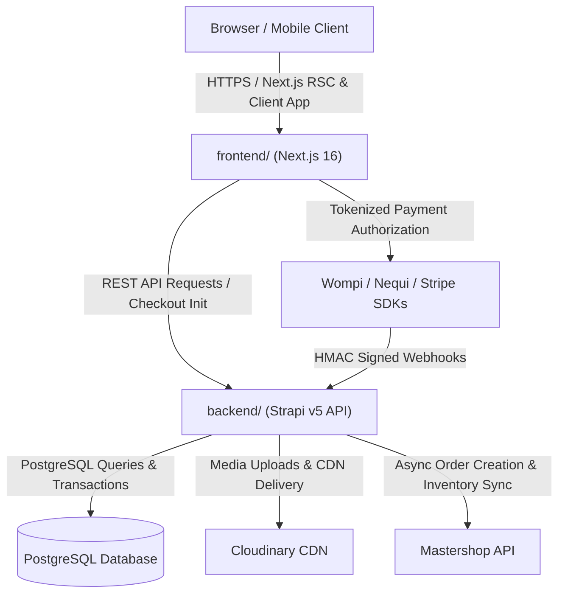
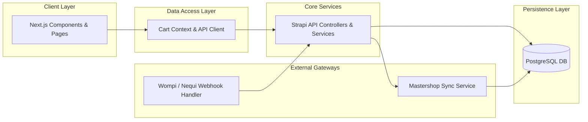
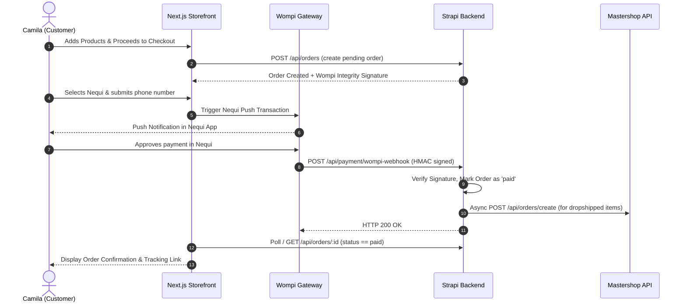
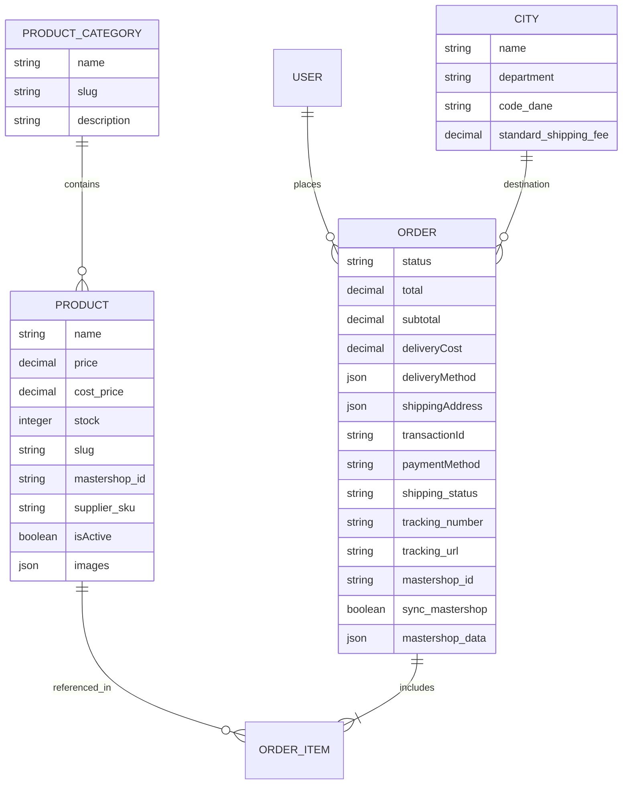

# Architecture Spine — Prana Market

## Design Paradigm

**Decoupled Headless Commerce + Asynchronous Event-Driven Webhook Pipeline**

- **Frontend (`frontend/`)**: Next.js 16 App Router. React Server Components (RSC) handle high-performance catalog rendering and SEO indexing; Client Components govern interactive slide-over cart, DANE address validation, and Wompi/Nequi checkout triggers.
- **Backend CMS & API (`backend/`)**: Strapi v5 on Node.js with PostgreSQL. Houses product catalog, user permissions, order lifecycle state machine, and administrative dashboards.
- **Integration Bus & Workers**: Asynchronous webhook consumers for payment settlement (Wompi, Stripe) and scheduled background cron workers (`node-cron`) for Mastershop catalog/inventory synchronization.



---

## Dependency Direction & Boundary Rules



---

## Invariants & Rules

### AD-1 — Single Source of Truth for Orders & Status Orchestration `[ADOPTED]`

- **Binds:** `FR-PAY-01..04`, `FR-ADM-01`, `FR-DROP-03`
- **Prevents:** Distributed or conflicting order status between frontend, payment providers, and dropship suppliers.
- **Rule:** All order entities (`api::order.order`), status transitions (`pending` -> `paid` -> `processing` -> `shipped` / `delivered`), and fulfillment dispatches must execute exclusively within Strapi backend services. The Next.js frontend is strictly a consumer and must never directly mutate order lifecycle status or trigger supplier APIs.

### AD-2 — Cryptographic Webhook Verification & Idempotent Payment Settlement `[ADOPTED]`

- **Binds:** `FR-PAY-01`, `FR-PAY-02`, `FR-PAY-04`, `NFR-SEC-03`
- **Prevents:** Duplicate order fulfillment, payment replay attacks, or race conditions upon multiple webhook retries.
- **Rule:** All incoming payment webhooks (`/api/payment/wompi-webhook`, `/api/payment/stripe-webhook`) must compute and verify HMAC SHA-256 signatures using `WOMPI_INTEGRITY_SECRET` / `STRIPE_WEBHOOK_SECRET`. Webhook processing must be idempotent: checking `orders.transactionId` and current status before transitioning to `paid`. If already processed, respond immediately with HTTP 200 without re-triggering fulfillment.

### AD-3 — Unified Cart with Hybrid Sourcing Partitioning `[ADOPTED]`

- **Binds:** `FR-CAT-03`, `FR-DROP-01..03`, `UJ-2`
- **Prevents:** Cart fragmentation, multiple checkout steps, or inventory collisions between local stock and dropshipped products.
- **Rule:** A single cart and single checkout order accommodates mixed products. The Strapi `Order` entity stores items with an explicit fulfillment discriminator (`sourcing_type`: `"local"` | `"mastershop_dropship"`). Dropship items preserve `mastershop_id`, `supplier_sku`, and supplier cost for automated post-payment routing.

### AD-4 — Asynchronous Mastershop Dispatch & Fault Isolation `[ADOPTED]`

- **Binds:** `FR-DROP-03`, `FR-DROP-04`, `FR-ADM-02`
- **Prevents:** Payment webhook timeouts caused by external supplier API delays, and order loss during supplier downtime.
- **Rule:** Mastershop order creation (`POST /api/orders/create`) is triggered asynchronously after payment confirmation is committed to PostgreSQL. Transient API failures must not roll back payment status; failures are recorded in `orders.mastershop_data.error` with `sync_mastershop: true` for automatic retry or manual admin resolution in Strapi.

### AD-5 — Client Cart Persistence & DANE Hierarchy Validation `[ADOPTED]`

- **Binds:** `FR-CART-01`, `FR-LOG-01`, `FR-LOG-02`, `NFR-UX-01`
- **Prevents:** Cart loss during browsing and mismatched Colombian address/shipping rate calculations.
- **Rule:** Cart items, quantities, and selected delivery options persist in `localStorage` synchronized via React Context. Shipping destination selectors must strictly follow the DANE standard hierarchy (Department -> Municipality -> Neighborhood). Pricing, discounts, and delivery fees calculated on the client are re-verified on the server before generating payment checkout signatures.

### AD-6 — Zero-Cardholder-Data Boundary (PCI-DSS Compliance) `[ADOPTED]`

- **Binds:** `NFR-SEC-01`, `FR-PAY-01`, `FR-PAY-02`
- **Prevents:** PCI-DSS scope expansion and credential leakage.
- **Rule:** No raw Credit Card PAN, CVV, expiration date, or Nequi security OTPs shall touch or be stored on Prana Market servers. All card tokenization and Nequi push requests are initiated through Wompi Widget / API tokenization endpoints or Stripe SDK on the client.

### AD-7 — Cloudinary Media Optimization & Next/Image Pipeline `[ADOPTED]`

- **Binds:** `NFR-PERF-01..03`, `FR-CAT-02`
- **Prevents:** Slow mobile page loads (LCP > 2.0s) and Cumulative Layout Shift (CLS) caused by unoptimized beauty product images.
- **Rule:** All uploaded and synced product assets are processed and served via Cloudinary (`@strapi/provider-upload-cloudinary`). Frontend displays catalog media strictly via `next/image` with responsive widths (`sizes="(max-width: 640px) 100vw, 50vw"`), WebP/AVIF formatting, and explicit aspect ratios.

---

## Consistency Conventions

| Concern | Convention |
| --- | --- |
| **Monetary Amounts & Currency** | Integer values in Colombian Pesos (COP) (e.g. `50000` for COP $50.000). No fractional centavos stored. |
| **Identifiers & Keys** | Strapi UUID/Numeric IDs for internal entities; Prefixed external strings for dropshipping (`mastershop_id`, `dropi_id`, `wompi_transaction_id`). |
| **Dates & Timestamps** | ISO 8601 UTC strings (`YYYY-MM-DDTHH:mm:ss.sssZ`). |
| **Order Status Lifecycle** | Strict sequential enum: `pending` $\rightarrow$ `paid` $\rightarrow$ `processing` $\rightarrow$ `shipped` $\rightarrow$ `delivered` (or terminal `cancelled` / `refunded`). |
| **Error Response Envelope** | `{ "data": null, "error": { "status": 400, "name": "ValidationError", "message": "...", "details": {} } }` |
| **API Route Naming** | Kebab-case plurals (e.g., `/api/products`, `/api/orders`, `/api/payment/wompi-webhook`). |
| **Environment Variables** | Uppercase snake_case prefixed by context (`STRAPI_URL`, `NEXT_PUBLIC_STRAPI_URL`, `WOMPI_PUBLIC_KEY`, `WOMPI_INTEGRITY_SECRET`, `MASTERSHOP_API_KEY`). |

---

## Stack (Seed)

| Name | Version | Role |
| --- | --- | --- |
| **Next.js** | `16.1.2` (Turbopack) | Frontend Web App & Server-Side Rendering |
| **React / React DOM** | `19.1.0` | Frontend UI Component Engine |
| **Tailwind CSS** | `4.x` | Design Tokens & Responsive Utility Styling |
| **Framer Motion** | `12.29.2` | Fluid Micro-Animations & Drawer Transitions |
| **Lucide React** | `0.563.0` | UI Icons |
| **Strapi** | `5.33.1` | Headless CMS, REST API & Admin Panel |
| **PostgreSQL (`pg`)** | `8.8.0` | Primary Relational Database |
| **Cloudinary Provider** | `5.33.4` | Media Asset Storage & On-the-Fly Image Transformation |
| **Node-cron** | `4.2.1` | Mastershop Sync & Stock Background Scheduling |
| **Nodemailer** | `7.0.12` | Order Confirmation & Tracking Email Dispatch |
| **Wompi API** | `v1 REST / Widget` | Colombian Payment Gateway (Nequi, PSE, Cards, Efecty) |
| **Stripe SDK** | `18.5.0` | Secondary / International Payment Gateway |

---

## Structural Seed

### System Context & Data Flow



### Core Entity Relationships (ERD)



### Source Tree Organization

```text
prana-market/
├── backend/
│   ├── config/                      # Server, database, plugins & cron configurations
│   ├── src/
│   │   ├── api/
│   │   │   ├── order/               # Order controllers, services, routes & content-types
│   │   │   ├── product/             # Product catalog models & routes
│   │   │   ├── product-category/    # Taxonomy & categorization
│   │   │   ├── city/                # Colombian DANE cities and shipping rates
│   │   │   └── payment/             # Wompi/Stripe webhook handlers & signature utils
│   │   ├── plugins/                 # Custom Strapi extension plugins
│   │   └── index.ts                 # Bootstrap lifecycle, cron initialization
│   └── scripts/                     # DANE city seeders & cleanup scripts
│
├── frontend/
│   ├── src/
│   │   ├── app/
│   │   │   ├── api/                 # Next.js route handlers (proxies, local checkout helpers)
│   │   │   ├── product/[slug]/      # PDP dynamic server & client views
│   │   │   ├── orders/              # Order status & public tracking portal
│   │   │   ├── payment/             # Checkout confirmation, Nequi QR/push modal
│   │   │   ├── layout.tsx           # Root layout with CartDrawer & Header
│   │   │   └── page.tsx             # Curated beauty storefront homepage
│   │   ├── components/              # Modular UI components (Cart, PDP, Swatches, Badges)
│   │   ├── context/                 # CartContext & CheckoutContext state providers
│   │   └── utils/                   # Formatting (COP currency), API fetchers, DANE helpers
│   └── public/                      # Static brand assets and icons
│
└── docs/                            # Deployment & operational architecture guides
```

---

## Capability $\rightarrow$ Architecture Map

| Capability / Requirement | Lives in | Governed by |
| --- | --- | --- |
| **FR-CAT-01..04: Catalog & PDP** | `frontend/src/app/product/`, `backend/src/api/product` | `AD-7`, `AD-3`, REST API |
| **FR-CART-01..04: Slide-Over Cart** | `frontend/src/components/cart/`, `frontend/src/context/` | `AD-5`, `localStorage` persistence |
| **FR-PAY-01..04: Wompi/Nequi/Stripe** | `frontend/src/app/payment/`, `backend/src/api/payment` | `AD-1`, `AD-2`, `AD-6` |
| **FR-DROP-01..04: Mastershop Sync** | `backend/src/api/product/services`, `backend/config/cron` | `AD-3`, `AD-4` |
| **FR-LOG-01..03: DANE Matrix & Rates** | `frontend/src/utils/`, `backend/src/api/city` | `AD-5`, DANE standard |
| **FR-ADM-01..03: Admin Management** | `backend/src/admin/`, `backend/src/api/order` | `AD-1`, `AD-4` |
| **NFR-PERF-01..03: Core Web Vitals** | `frontend/src/app/`, Cloudinary Provider | `AD-7`, Next/Image |
| **NFR-SEC-01..03: Security & PCI** | `backend/src/api/payment`, Wompi SDK | `AD-2`, `AD-6` |

---

## Deferred

| Item | Reason for Deferral |
| --- | --- |
| **DIAN Electronic Invoicing (Facturación Electrónica)** | Pushed to Phase 3 after MVP launch; initial transaction receipts satisfy legal e-commerce order confirmation standards. |
| **Multi-Warehouse Physical Inventory Routing** | Prana Market launches with a single local warehouse location plus Mastershop dropship routing; multi-store physical partitioning will be modeled when physical storefronts scale. |
| **Real-time Mastershop Webhook Push Receiver** | Initial implementation relies on reliable background polling / sync cron; direct webhook ingestion from Mastershop will be enabled once Mastershop webhook endpoints are officially provisioned. |
