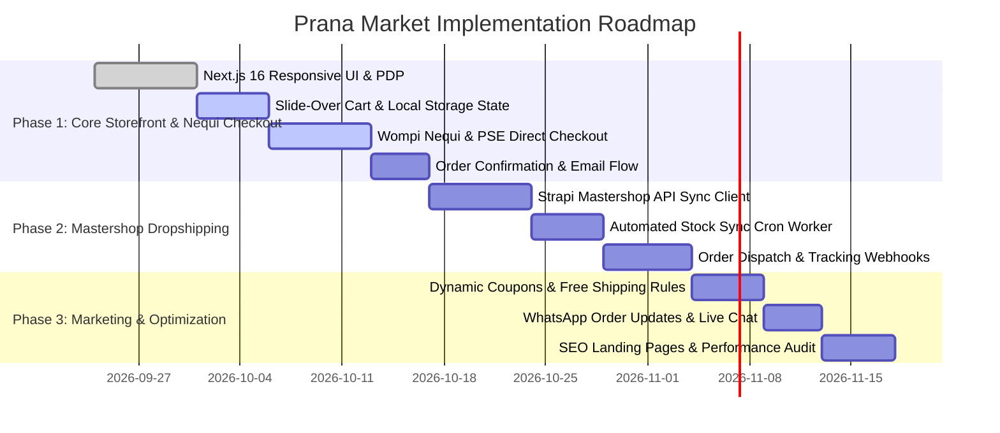

# Prana Market — Product Requirements Document (PRD)

## 1. Executive Summary & Product Vision

### 1.1 Vision Statement
**Prana Market** aspires to be the #1 online cosmetics and makeup destination in Colombia, combining unbeatable competitive pricing with curated high quality and an expansive multi-brand product catalog.

### 1.2 Core Business Model & Hybrid Sourcing
Prana Market operates a **hybrid inventory model**:
1. **Owned / Direct Physical Inventory**: High-demand local makeup and beauty products fulfilled directly from local stock (store pickup & local express delivery).
2. **Automated Dropshipping via Mastershop**: Infinite-aisle expansion offering multi-brand cosmetics without upfront warehousing risks, synced directly via Mastershop APIs/webhooks for automated cataloging, stock tracking, and supplier fulfillment.

### 1.3 Target Audience & Market Positioning
- **Primary Consumers**: Colombian beauty enthusiasts, students, professionals, and makeup artists seeking trending cosmetic brands at accessible price points with seamless mobile payment methods (Nequi, PSE, cards).
- **Geographic Focus**: Urban centers (Bogotá, Medellín, Cali, Barranquilla, Bucaramanga) with nationwide delivery reach across all Colombian municipalities.

---

## 2. Success Metrics & Counter-Metrics

### 2.1 Primary Business & Conversion Metrics
- **Mobile Checkout Conversion Rate**: $\ge 3.8\%$ on mobile devices.
- **Nequi Payment Completion Rate**: $\ge 88\%$ of initiated Nequi transactions completed without drop-off.
- **Cart-to-Purchase Abandonment Rate**: Under $55\%$ (industry benchmark ~70%).
- **Average Order Value (AOV)**: Target COP \$85,000+ driven by cross-selling and tiered free shipping thresholds.

### 2.2 Operational & Fulfillment Metrics
- **Dropshipping Order Processing Latency**: $< 15$ minutes from payment confirmation to Mastershop order dispatch.
- **Stock Synchronization Accuracy**: $99.5\%$ real-time accuracy preventing out-of-stock purchases.

### 2.3 Counter-Metrics (Guardrails)
- **Supplier Order Cancellation Rate**: $< 2.0\%$ (must not sacrifice catalog reliability for inventory scale).
- **Return / Dispute Rate**: $< 1.5\%$ of shipped orders.
- **Page Load Time (LCP on Mobile 4G)**: Under 2.0 seconds (preventing image-heavy beauty assets from degrading checkout speed).

---

## 3. User Personas & Key User Journeys

### 3.1 Persona Profiles

#### Persona A: Camila (23, Mobile-First Beauty Shopper)
- **Context**: Discovers trending lip oils and foundations on TikTok/Instagram. Buys directly from her phone using money in her Nequi account.
- **Pain Point**: Long checkouts requiring credit card numbers or complex registration; fear of counterfeit makeup products.

#### Persona B: Laura (31, Professional & Multi-Brand Enthusiast)
- **Context**: Purchases both high-end and budget-friendly beauty essentials in single orders; needs fast home delivery and transparent tracking.
- **Pain Point**: High shipping costs across fragmented stores and slow fulfillment updates.

#### Persona C: Store Operator / Admin (Prana Ops)
- **Context**: Manages local inventory, monitors Mastershop synchronization, updates promotions, and tracks dispatch status.
- **Pain Point**: Manual order transfers to dropshipping providers and stock mismatch errors.

---

### 3.2 Core User Journeys (UJ)

#### [UJ-1] Frictionless Mobile Purchase with Nequi
1. **Discovery**: Camila lands on a trending lip tint product page via mobile browser.
2. **Cart Addition**: Taps "Añadir al Carrito"; sticky mini-cart provides instant visual feedback with free shipping progress bar.
3. **Smart Checkout**: Opens slide-over cart, enters Colombian delivery details (City/Department auto-complete), and selects **Nequi** as preferred payment.
4. **Push / Dynamic QR Authorization**: System prompts Nequi push notification or phone number verification; Camila confirms in her Nequi app in under 30 seconds.
5. **Confirmation**: Instant WhatsApp / Email order confirmation with real-time tracking link.

#### [UJ-2] Hybrid Cart & Transparent Shipping Experience
1. **Multi-Brand Selection**: Laura adds 1 local warehouse product (mascara) and 1 Mastershop dropshipped product (eyeshadow palette).
2. **Delivery Option Resolution**: Cart automatically calculates unified shipping or clarifies estimated delivery windows for split items.
3. **Payment & Receipt**: Completes payment with PSE / Credit Card via Wompi; receives unified receipt with broken-down fulfillment timelines.

#### [UJ-3] Automated Mastershop Dropshipping Pipeline
1. **Product Ingestion**: Admin imports curated product lines from Mastershop with automated markup pricing rules.
2. **Order Routing**: Customer purchase triggers webhook; backend verifies payment settlement and creates corresponding fulfillment order in Mastershop API.
3. **Dispatch Tracking**: Mastershop generates national carrier tracking guide (Servientrega, Coordinadora, Interrapidísimo); status updates automatically reflect in customer portal and notifications.

---

## 4. Functional Requirements (FR)

### 4.1 Product Catalog & Merchandising (FR-CAT)
- **[FR-CAT-01] Multi-Brand & Category Taxonomy**: Hierarchical category tree (Rostro, Ojos, Labios, Skincare, Accesorios, Sets) with multi-brand filtering.
- **[FR-CAT-02] Rich Product Detail Page (PDP)**: High-resolution image galleries, shade/color variant swatches, ingredients list, usage guides, and customer reviews.
- **[FR-CAT-03] Inventory Origin Badge**: Explicit indicator if product ships via Express Local Delivery or National Dropshipping.
- **[FR-CAT-04] Smart Search & Filters**: Typeahead search, filters by brand, skin type, finish (matte/glow), price range (COP), and in-stock availability.

### 4.2 Shopping Cart & Conversion Optimization (FR-CART)
- **[FR-CART-01] Persistent Slide-Over Cart**: High-speed drawer cart accessible across all pages with real-time state persistence (`localStorage` + Context API).
- **[FR-CART-02] Dynamic Shipping Progress Bar**: Visual threshold indicator ("¡Agrega \$25.000 más para Envío Gratis!").
- **[FR-CART-03] One-Click Quantity & Variant Adjustment**: Instant quantity toggling, variant switching, and removal without page reload.
- **[FR-CART-04] Coupon & Promo Code Engine**: Support for percentage, fixed COP discounts, and first-order promotional coupons.

### 4.3 Colombian Checkout & Payment Processing (FR-PAY)
- **[FR-PAY-01] Nequi Direct Checkout Flow**: Native Nequi payment integration via Wompi API allowing seamless phone-number push approval or dynamic QR code.
- **[FR-PAY-02] Comprehensive Colombian Payment Gateway**: Full integration with Wompi supporting:
  - PSE (all Colombian banks)
  - Credit & Debit Cards (Visa, Mastercard, Amex)
  - Bancolombia Transfer
  - Cash Networks (Efecty, Baloto, SuRed)
- **[FR-PAY-03] Stripe International Backup**: Dual-gateway failover and international card acceptance in COP currency.
- **[FR-PAY-04] Automated Webhook Reconciliation**: Asynchronous webhook handler for payment settlement, handling retries, idempotency keys, and instant status updates.

### 4.4 Dropshipping & Mastershop Integration (FR-DROP)
- **[FR-DROP-01] Catalog Import & Mapping**: Automated synchronization of products, descriptions, variants, and media assets from Mastershop into Strapi CMS.
- **[FR-DROP-02] Real-Time Stock & Price Sync**: Scheduled background workers (cron/webhooks) syncing supplier stock levels and adjusting dynamic margins.
- **[FR-DROP-03] Automated Order Dispatch**: Automatic creation of dropshipping orders in Mastershop upon confirmed payment in Prana Market.
- **[FR-DROP-04] Multi-Carrier Tracking Ingestion**: Ingestion of tracking numbers and courier links (Envia, Coordinadora, Interrapidísimo, TCC) pushing automated WhatsApp/Email notifications to buyers.

### 4.5 Logistics & Colombian Delivery Matrix (FR-LOG)
- **[FR-LOG-01] Colombian Address Matrix**: Hierarchical Department -> Municipality/City -> Neighborhood selector matching DANE standards.
- **[FR-LOG-02] Tiered Delivery Options**:
  - *Store Pickup / Recogida en Tienda*: Free (configured physical store address).
  - *Local Urban Express*: Flat fee COP \$5,000 (1-2 business days).
  - *Regional / National Standard*: Flat fee COP \$10,000 or calculated based on Mastershop carrier rates.
- **[FR-LOG-03] Order Tracking Portal**: Public tracking page allowing customers to track order status by Order Number + Email/Phone.

### 4.6 Administration & Operations (FR-ADM)
- **[FR-ADM-01] Unified Order Management Dashboard**: Centralized Strapi admin dashboard displaying order status (Pendiente, Pagado, En Preparación, Despachado, Entregado, Cancelado).
- **[FR-ADM-02] Dropshipping Status Monitor**: Dedicated view for monitoring Mastershop fulfillment sync status, API error logs, and manual override options.
- **[FR-ADM-03] Customer Service & WhatsApp Integration**: Floating WhatsApp chat widget and direct order issue resolution shortcuts.

---

## 5. Non-Functional Requirements (NFR)

### 5.1 Performance & Core Web Vitals (NFR-PERF)
- **[NFR-PERF-01]** Largest Contentful Paint (LCP) $\le 2.0\text{s}$ on standard mobile 4G connections.
- **[NFR-PERF-02]** Cumulative Layout Shift (CLS) $< 0.05$ across all responsive breakpoints.
- **[NFR-PERF-03]** Image optimization pipeline utilizing Cloudinary / Next.js Image with WebP/AVIF formats and responsive sizing.

### 5.2 Responsive UI/UX & Design Standards (NFR-UX)
- **[NFR-UX-01] Mobile-First Ergonomics**: Sticky bottom action bars on PDP and cart drawer optimized for one-handed thumb interactions.
- **[NFR-UX-02] Modern Aesthetics**: Premium beauty aesthetic with soft rose/nude accents, crisp typography, clean micro-interactions, and accessible contrast ratios (WCAG AA).
- **[NFR-UX-03] Feedback & Micro-animations**: Instant optimistic UI updates for cart modifications, smooth loading skeletons, and clear validation states.

### 5.3 Security & Compliance (NFR-SEC)
- **[NFR-SEC-01] PCI-DSS Compliance**: No raw cardholder data touches Prana Market servers; tokenization handled directly by Wompi / Stripe iframe/widget SDKs.
- **[NFR-SEC-02] Colombian Habeas Data Compliance (Ley 1581 de 2012)**: Explicit consent checkboxes for privacy policy, terms of service, and commercial communication.
- **[NFR-SEC-03] Webhook Security**: Cryptographic HMAC signature verification on all incoming Wompi, Stripe, and Mastershop webhooks.

---

## 6. Assumptions & Dependencies

### 6.1 Explicit Assumptions (`[ASSUMPTION]`)
- **[ASSUMPTION-01] Mastershop API Access**: Mastershop provides REST or GraphQL endpoints with API Key / OAuth authentication for catalog fetching, inventory lookup, and order placement.
- **[ASSUMPTION-02] Unified Customer Checkout**: Customers purchasing both local and dropshipped products in a single order accept separate shipments if delivery timelines differ.
- **[ASSUMPTION-03] Currency Standardization**: All transactions, product prices, and accounting values are denominated and settled in Colombian Pesos (COP).
- **[ASSUMPTION-04] Wompi Merchant Account**: Active Colombian merchant account with Wompi ready to process Nequi, PSE, and cards in production.

### 6.2 Key External Dependencies
- **Backend CMS**: Strapi v5 (PostgreSQL, Cloudinary media provider).
- **Frontend App**: Next.js 16 (React 19, Turbopack, Tailwind CSS v4).
- **Payment Providers**: Wompi API (Primary) + Stripe API (Secondary).
- **Dropshipping Partner**: Mastershop Platform API & Webhook Service.

---

## 7. Implementation Phasing & Roadmap

### Phase 1: MVP Storefront & Nequi-Optimized Checkout (Weeks 1-2)
- Polished mobile-first beauty catalog and responsive PDP.
- High-converting slide-over cart with real-time totals.
- Production Wompi integration with Nequi push, PSE, and cards.
- Strapi v5 order persistence and email notifications.

### Phase 2: Mastershop Dropshipping Automation (Weeks 3-4)
- Mastershop catalog sync (products, variants, images, pricing margins).
- Real-time inventory synchronization worker.
- Automated order forwarding and tracking guide ingestion.

### Phase 3: Growth, Loyalty & Logistics Polish (Weeks 5+)
- Dynamic bundle deals and coupon campaigns.
- Automated WhatsApp notifications for tracking updates.
- SEO landing pages for high-volume makeup categories.

---

## 8. Open Questions & PM Notes

1. **[OPEN-Q1] Mastershop API Specification**: Are we connecting via Mastershop's direct REST API, webhook endpoints, or a CSV/Webhook bridge?
2. **[OPEN-Q2] Shipping Cost Strategy**: Should Prana Market offer a flat rate for dropshipping or pass through real-time carrier quotes calculated at checkout?
3. **[OPEN-Q3] Brand Verification & Invoicing**: Will DIAN electronic invoicing (Facturación Electrónica) be required at launch or handled via external integration?
