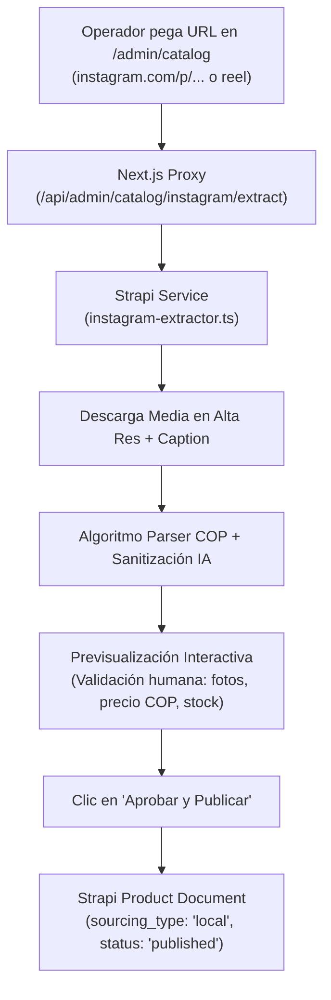

# 📦 Guía de Configuración e Integración: Catálogo Físico e Importador Inteligente desde Instagram (Epic 8)

Esta guía documenta la arquitectura, configuración, endpoints y manual de uso operativo de la **Epic 8: Gestión de Inventario Físico, Importador de Instagram con IA y Despacho Híbrido** en **Prana Market** (Strapi v5 + Next.js 16).

---

## 🧭 1. Visión General del Modelo Híbrido

Prana Market opera con dos orígenes de inventario simultáneos en el mercado colombiano:

| Origen (`sourcing_type`) | Fuente de Producto | Almacenamiento & Despacho | Proveedor de Logística |
| :--- | :--- | :--- | :--- |
| `local` | Bodega Propia / Tienda Física / Instagram | Bodega Local de Prana Market | Mensajería Local, Servientrega, Coordinadora, Interrapidísimo |
| `mastershop_dropship` | Catálogo de Proveedores MasterShop | Bodega Externa del Proveedor | MasterShop API / Envíos Nacionales Automatizados |

### La Regla de Oro del Aislamiento
> **CRÍTICO:** Los productos con `sourcing_type: 'local'` **nunca** deben ser alterados por sincronizaciones de MasterShop, ni los pedidos de bodega local deben enviarse al API de MasterShop. El importador desde Instagram y la carga CSV aseguran este aislamiento de forma estricta.

---

## 🤖 2. Story 8.4: Importador Inteligente desde Instagram

Herramienta asistida por IA ubicada en `/admin/catalog` que permite a los operadores digitalizar publicaciones del feed y reels de Instagram en productos de la tienda en menos de 15 segundos.



### 2.1 Capacidades del Algoritmo de Extracción
* **Normalización de Precios en Pesos Colombianos (COP):**
  * Detecta formatos estándar: `"$85.000"`, `"85.000 COP"`, `"$120.000"`.
  * Detecta jerga y abreviaturas colombianas: `"75k"` $\rightarrow$ `75000`, `"120 mil"` $\rightarrow$ `120000`, `"precio: 45000"` $\rightarrow$ `45000`.
* **Sanitización de Copy Comercial:**
  * Remueve llamados a la acción sociales que no aplican a la tienda web: `"escríbenos al DM"`, `"link en bio"`, `"pídelo a nuestro WhatsApp"`, enlaces directos y números celulares.
  * Remueve muros de hashtags (`#colombia #maquillaje #moda`).
  * Limpia emojis no deseados en el título principal.
* **Extracción de Variantes:**
  * Detecta tallas en el texto: `XS`, `S`, `M`, `L`, `XL`, `ÚNICA`.
  * Detecta colores comunes: `Beige`, `Negro`, `Blanco`, `Lino`, `Nude`, `Rosado`, etc.
* **Clasificación Automática de Categoría:**
  * Mapea inteligentemente según palabras clave:
    * `accesorios`: brochas, esponjas, cosmetiqueras, rizadores.
    * `skincare`: serums, cremas, tónicos, limpiadores, bloqueadores.
    * `labios`: labiales, gloss, tintas.
    * `ojos`: pestañinas, sombras, delineadores.
    * `rostro`: bases, correctores, polvos, rubores, iluminadores.

---

## 📄 3. Story 8.1: Carga Masiva de Catálogo Local (CSV)

Para operadores que ya cuentan con un inventario en hojas de cálculo (Excel / Google Sheets), el panel `/admin/catalog` proporciona carga masiva por archivo delimitado por comas.

### Estructura de la Plantilla CSV (`template-productos-prana.csv`)

| Columna | Tipo | Requerido | Descripción / Ejemplo |
| :--- | :--- | :--- | :--- |
| `sku` | Texto único | **Sí** | Identificador de bodega (ej: `PRANA-LOC-001`) |
| `name` | Texto | **Sí** | Nombre comercial (ej: `Labial Hidratante Rosa`) |
| `category_slug` | Slug | **Sí** | `labios`, `ojos`, `rostro`, `skincare`, `accesorios`, `sets` |
| `price` | Entero | **Sí** | Precio final en COP (ej: `45000`) |
| `cost_price` | Entero | No | Costo de adquisición (ej: `25000`) |
| `stock` | Entero | **Sí** | Unidades físicas en bodega (ej: `20`) |
| `description` | Texto | No | Descripción para la ficha técnica del producto |
| `is_active` | Booleano | No | `true` o `false` |

---

## 🛡️ 4. Reglas de Protección y Seguridad de Catálogo

1. **Protección contra colisiones de SKU:**
   Si un operador intenta importar un producto con un SKU que ya existe y pertenece a MasterShop (`sourcing_type === 'mastershop_dropship'`), la petición es rechazada de inmediato con un error explícito:
   ```json
   {
     "error": "El SKU '...' pertenece al catálogo de dropshipping de MasterShop y no puede ser modificado desde el importador local."
   }
   ```
2. **Forzado Inmutable de `sourcing_type`:**
   Cualquier producto ingresado mediante el importador de Instagram o CSV se graba estrictamente con `sourcing_type: 'local'`.
3. **Persistencia de Imágenes:**
   Las imágenes extraídas se vinculan al Media Library o almacenamiento seguro para evitar enlaces rotos causados por la expiración periódica de tokens del CDN de Instagram.

---

## 🔌 5. Referencia de Endpoints API

### 5.1 Extracción de Publicación de Instagram
* **Ruta Strapi:** `POST /api/products/extract-instagram`
* **Ruta Next.js Proxy:** `POST /api/admin/catalog/instagram/extract`
* **Acceso:** Libre / Admin

#### Request Body
```json
{
  "postUrl": "https://www.instagram.com/p/DAxyz123/"
}
```

#### Response Exitosa (HTTP 200)
```json
{
  "success": true,
  "draft": {
    "shortcode": "DAxyz123",
    "original_url": "https://www.instagram.com/p/DAxyz123/",
    "name": "Vestido Midi en Lino Crudo",
    "price": 85000,
    "description": "Hermoso vestido midi elaborado en lino de alta calidad con ajuste cómodo y fresco.",
    "images": [
      "https://instagram.com/p/DAxyz123/media/?size=l"
    ],
    "variants": {
      "sizes": ["S", "M", "L"],
      "colors": ["Lino", "Beige"]
    },
    "suggested_category_slug": "moda",
    "sku": "PRANA-IG-DAXYZ123",
    "sourcing_type": "local"
  }
}
```

---

### 5.2 Publicación de Producto Aprobado
* **Ruta Strapi:** `POST /api/products/publish-instagram`
* **Ruta Next.js Proxy:** `POST /api/admin/catalog/instagram/publish`

#### Request Body
```json
{
  "name": "Vestido Midi en Lino Crudo",
  "price": 85000,
  "stock": 10,
  "category_slug": "moda",
  "sku": "PRANA-IG-DAXYZ123",
  "description": "Hermoso vestido midi elaborado en lino de alta calidad.",
  "images": ["https://instagram.com/p/DAxyz123/media/?size=l"],
  "sourcing_type": "local"
}
```

#### Response Exitosa (HTTP 200)
```json
{
  "success": true,
  "message": "Producto de Instagram publicado exitosamente en catálogo local.",
  "product": {
    "id": 42,
    "documentId": "abc123def456",
    "name": "Vestido Midi en Lino Crudo",
    "price": 85000,
    "stock": 10,
    "sourcing_type": "local",
    "isActive": true,
    "slug": "vestido-midi-en-lino-crudo-123456"
  }
}
```

---

## 💻 6. Variables de Entorno

### `frontend/.env.local`
```env
# URL base de la API de Strapi
NEXT_PUBLIC_STRAPI_URL=http://localhost:1337
```

### `backend/.env`
```env
# URL del frontend para enlaces y CORS
FRONTEND_URL=http://localhost:3000

# Cloudinary (opcional para almacenamiento CDN de fotos importadas)
CLOUDINARY_NAME=tu_cloud_name
CLOUDINARY_KEY=tu_api_key
CLOUDINARY_SECRET=tu_api_secret
```

---

## 🖥️ 7. Guía de Uso para el Operador

1. Ingresa a la interfaz web de administración: `http://localhost:3000/admin/catalog`.
2. Verás dos pestañas:
   * **Importar desde Instagram (IA)** (activa por defecto).
   * **Carga Masiva CSV**.
3. En la pestaña de Instagram:
   * Copia el enlace de cualquier publicación o reel público de Instagram (ej: `https://www.instagram.com/p/C-xyz123/`).
   * Pégalo en la barra de entrada y haz clic en **"Extraer Producto"**.
4. En 2-3 segundos se desplegará la **Tarjeta de Previsualización**:
   * Si el post tiene carrusel, puedes hacer clic en las miniaturas para inspeccionar las fotos.
   * Modifica el nombre, precio en COP, stock de bodega o categoría si deseas afinar algún dato.
5. Haz clic en **"Aprobar y Publicar en Catálogo"**.
6. El producto quedará disponible de inmediato en la tienda online con la etiqueta de **Bodega Local**.

---

## 🧪 8. Verificación Automatizada

Para validar que todos los parsers, rutas y controles de aislamiento funcionan al 100%, ejecuta el script de pruebas en la raíz del backend:

```bash
node backend/scripts/verify-epic8-story4.js
```

### Cobertura de Pruebas:
* [x] Validación de estructura de archivos y rutas.
* [x] Normalización de expresiones de precios colombianos (`COP`, `$`, `k`, `mil`).
* [x] Limpieza de CTAs de WhatsApp, DMs y hashtags.
* [x] Detección de taxonomía y orden de precedencia de categorías.
* [x] Validación de no-sobreescritura sobre productos MasterShop.
* [x] Verificación de componentes de interfaz y enlaces de navegación del panel.
